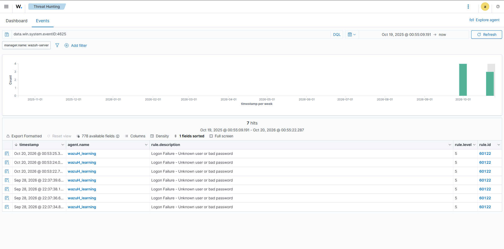

# Investigation 01 — Controlled Password Spray

**Status:** The password-spray hypothesis is unverified. The published overview shows seven 4625 search results in a broad selected range, but does not establish the source/account/time pattern required to confirm a spray.

## Scenario

A single test source makes one failed SMB authentication attempt against several existing, disposable lab accounts on the Windows endpoint. The pattern of interest is one password tested across multiple users, rather than many passwords tested against one user. This case is independent of every other investigation in this repository.

## Lab boundary and safe setup

Run only on the isolated, host-only lab network. Use accounts created solely for this exercise and one deliberately incorrect lab password, at a low rate. Do not target personal, production, or third-party accounts. Stop if an account locks or traffic reaches an unexpected host. Do not create a successful login as part of this case; a later success would be a separate follow-up observation to document only if it actually occurs.

## Detection and investigation

- Primary Windows Security event: **4625** — failed logon.
- Wazuh search starting point: data.win.system.eventID:4625.
- Review the time range around the controlled exercise. Raw events may be present even when no custom password-spray correlation rule is configured; do not claim that an alert fired unless the dashboard shows it.
- Record the timestamp, endpoint/agent, target account, source IP, logon type, workstation name, failure status/substatus, and Wazuh rule ID/level when available.
- Group events by source IP and short time window. Count distinct targeted accounts and compare the pattern with the known test actions.
- Check for a matching **4624** successful logon from the same source and time range. A failed attempt alone does not establish compromise.

## Assessment criteria

Treat the pattern as a suspected password spray only when the observed events show the same source making failures against multiple accounts in a compact time window and the pattern is not explained by the documented test or approved activity. Escalate the assessment if evidence shows a successful logon, lockout, or additional suspicious behavior. Otherwise, document the result as an attempted authentication pattern and state the detection limits.

## Evidence currently available

*The overview shows seven results for the 4625 search and rule ID 60122 in the selected broad range. It does not show a compact exercise window, source-to-account aggregation, or enough event detail to establish a password spray. No 4624 result is correlated to the same source, account, and time window in the reviewed evidence. The case remains unconfirmed.*

## Observed evidence

| Field | Observed value |
|---|---|
| Exercise time range | Broad selected search range; a compact exercise window is not established |
| Visible Wazuh rule | Rule ID 60122; level is not recorded in the overview |
| Analyst disposition | Inconclusive; the overview does not meet the password-spray criteria |
