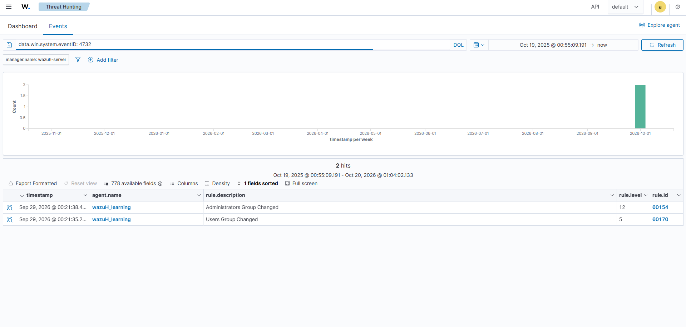

# Investigation 03 — Unexpected Privileged Group Change

**Status:** Partial overview evidence is available: the 4732 search shows two group-change results. The actor, affected member, resulting membership, and authorization have not been verified from expanded event details.

## Scenario

An existing standard lab account is unexpectedly added to the local Windows Administrators group. The investigation asks who made the change, which account was added, whether the activity was approved, and whether the group membership persisted. It is independent of the password-spray and PowerShell scenarios; do not imply that the same actor or host was involved unless evidence shows it.

## Lab boundary and safe setup

Use only a disposable Windows VM and an existing test account. Perform a single controlled group-membership change during the lab exercise, then preserve the event details. Do not use a personal or production administrator account. Restore the original test membership after preserving evidence, and document that cleanup separately.

## Detection and investigation

- Primary Windows Security event: **4732** — a member was added to a security-enabled local group. For domain global or universal groups, verify whether **4728** or **4756** applies instead.
- Wazuh search starting point: `data.win.system.eventID:4732`.
- Record the event time, computer/agent, subject account and logon ID, member account/SID, target group name/SID, and Wazuh rule ID/level.
- Validate the group and member using the event details and the endpoint's current local group membership. Confirm the actor's session and whether the change matches an approved administrative task or maintenance record.
- Search for nearby related events only within this case's time window. Do not add account creation, failed logons, or unrelated process activity to the narrative without evidence.

## Assessment criteria

A group-change event proves that a membership change was recorded; it does not by itself prove malicious intent. Classify it as expected only when the actor, target account, timing, and authorization are supported. Treat an unexplained change that grants administrative rights as a high-priority access-control concern and recommend removing unauthorized membership through the lab's approved process.

## Evidence currently available (overview only)

*The overview shows two results for the 4732 search with group-change descriptions. It does not display the expanded actor/member fields, confirm resulting membership, or show authorization. The specific scenario in this case remains unverified.*

## Observed evidence

| Field | Observed value |
|---|---|
| Event time and timezone | Not established from the overview |
| Windows agent/hostname | Not established from the overview |
| Actor account and logon ID | Not visible in the overview |
| Added member account/SID | Not visible in the overview |
| Target group name/SID | Group-change descriptions are visible; exact event fields are not verified |
| Wazuh rule ID/level | Result overview only; event-level rule details are not recorded here |
| Authorization check and membership state | Not verified |
| Analyst disposition | Inconclusive; expanded event and authorization review are still needed |
