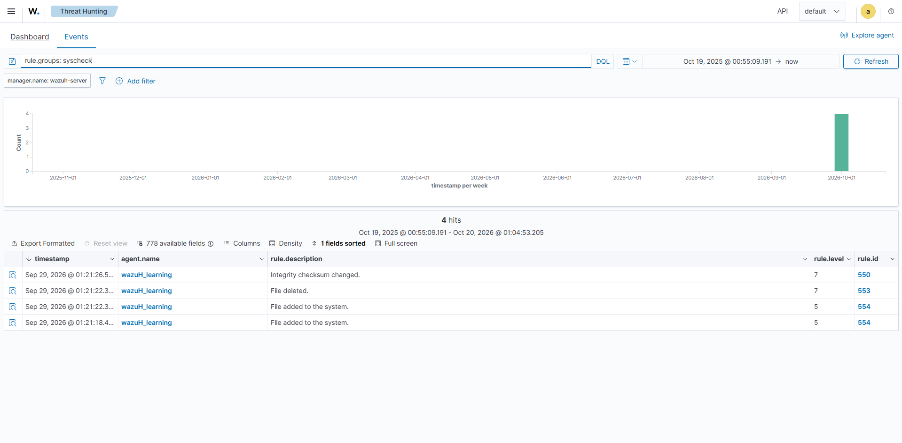

# Investigation 04 — Sensitive File Integrity Change

**Status:** Preliminary Syscheck overview evidence is available, but this case's dedicated marker-file exercise is not verified. The published search shows four Syscheck results without path-level context.

## Scenario

A monitored lab configuration file is modified outside its expected maintenance window. The investigation determines what changed, when it changed, and whether the activity was authorized. This uses a disposable lab fixture, not the Windows hosts file, production configuration, or files from another case.

## Lab boundary and safe setup

Configure Wazuh FIM to monitor a dedicated test directory named WazuhLab-FIM. Change only a harmless marker file in that directory. Do not alter operating-system, security, or business-critical files. Preserve the before/after contents and revert the marker after recording the event.

## Detection and investigation

- Primary telemetry: Wazuh File Integrity Monitoring (Syscheck) alert for a file added, modified, or deleted.
- Search the Wazuh alert data for Syscheck events and narrow to the observed file path and exercise time; field names can vary by Wazuh version.
- Record the agent, full path, event type, timestamp, user/process context if available, and before/after hashes shown in the event.
- Compare the change with the controlled test action and any approved maintenance record. FIM identifies a file change; it does not identify intent by itself.

## Assessment criteria

Treat an unexplained change to a sensitive monitored file as suspicious until the owner and expected content are verified. A controlled marker-file modification should be documented as a successful FIM validation only if the expected event and path appear in Wazuh. If the event is absent, record a collection or configuration gap rather than claiming detection.

## Evidence currently available (overview only)

*The rule.groups:syscheck search shows four Syscheck results, including file-change descriptions. This overview does not show the monitored path or verify the dedicated WazuhLab-FIM marker-file scenario. No path-level or benign/suspicious disposition is claimed.*

## Observed evidence

| Field | Observed value |
|---|---|
| Visible Wazuh rules | Search overview includes rule IDs 550, 553, and 554; event-level context was not reviewed |
| Analyst disposition | Inconclusive; the dedicated marker-file event is not verified |
