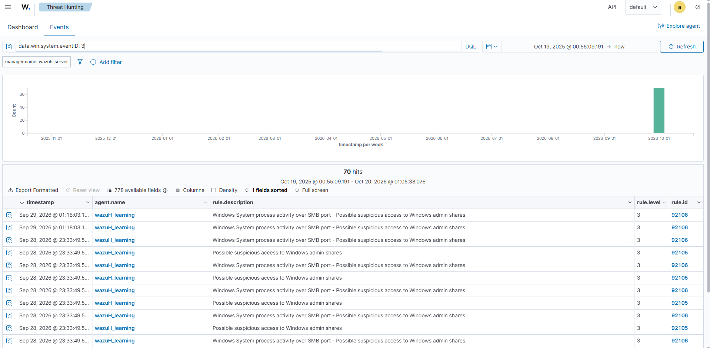

# Investigation 05 — Network Reconnaissance Visibility Review

**Status:** A broad network-event search overview is available, but the documented single-host connection-probe exercise is not verified by it.

## Scenario

An analyst reviews whether a low-volume connection probe against one authorized lab host is visible in the telemetry collected by Wazuh. The goal is to validate logging coverage and distinguish a genuine observation from a visibility gap.

## Safe lab boundary

Only perform a small, approved test against one host in an isolated lab network, within an agreed time window. Do not scan public addresses, production systems, or a subnet. If no approved test is available, use existing authorized lab telemetry and document that no exercise was run.

## Detection and investigation

- Identify the available endpoint or firewall telemetry before the exercise. Depending on configuration, relevant sources may include Sysmon network connection events, Windows Filtering Platform events, or firewall logs.
- Wazuh may not generate an alert from a connection probe unless the relevant event source is collected and a matching rule or query exists.
- Search within the actual exercise window and target host. Record the source, destination, port, event provider, event ID, agent, timestamp, and matching Wazuh rule/query if present.
- If the event is missing, check collection configuration and retention. Absence from Wazuh is a visibility gap, not proof that no connection occurred.

## Assessment criteria

State whether the expected telemetry was present, absent, or inconclusive. Separate raw event visibility from alerting: an event in Wazuh does not by itself establish malicious intent, and no alert does not establish that traffic was absent.

## Evidence currently available (broad search only)

*The broad data.win.system.eventID:3 search shows 70 results in the selected range, with SMB admin-share-related alert descriptions visible. It does not document the bounded connection probe in this case or show the source, destination, and port for that exercise. The specific scenario remains unverified.*

## Observed evidence

| Field | Observed value |
|---|---|
| Visible search query | data.win.system.eventID:3 |
| Overview results | 70 results in the selected broad range; SMB admin-share-related descriptions are visible, but the documented probe is not validated |
| Analyst disposition | Inconclusive for the probe scenario |
